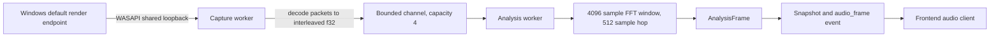

# Audio capture and analysis

This document follows system playback from the Windows output device to the analysis frame produced by the Rust backend. It describes the implementation in `src-tauri/src/audio/`; it is not a claim that synthetic tests prove live-device behavior.

## End-to-end path

## Capture lifecycle

The UI calls the Tauri `start_capture` command only after the user starts capture. `CaptureService` owns the session lifecycle and creates separate `audio-capture` and `audio-analysis` workers. Capture state moves through `idle`, `starting`, `running`, `recovering`, `stopping`, or `error`. Each start receives a generation number so late work from an old session cannot overwrite the current session.

On Windows, `WindowsWasapiCapture` opens the default **render** endpoint for the **multimedia** role in shared mode with loopback and event-callback flags. It does not open an input/microphone endpoint or take exclusive control of playback. A Windows notification callback watches for changes to that default render endpoint. On change, the active stream is released and the worker reopens the new default endpoint. Retryable device failures enter `recovering`; fatal failures enter `error` after worker cleanup.

COM objects and endpoint resources are created, used, and dropped on the capture worker. Stop signals the worker, joins capture and analysis off the UI thread, clears diagnostics, and returns the service to idle. Window close also shuts the service down before the app exits.

## Packet decoding and sample continuity

The Windows adapter parses the endpoint's native format into a plain `SampleFormat`. The decoder accepts IEEE float32 and signed PCM with 16-, 24-, or 32-bit containers (including PCM valid-bit widths supported by the descriptor). It converts little-endian samples to finite `f32` values in `[-1, 1]`, sign-extends packed 24-bit PCM, and turns WASAPI silent packets into zero-filled blocks. Samples remain interleaved by channel in `AudioBlock` and carry the sample rate and channel count.

WASAPI data-discontinuity and timestamp-error flags, device changes, and dropped analysis-channel blocks mark the next block discontinuous. The analyzer then resets its rolling window and temporal DSP state, avoiding a false transient caused by joining noncontiguous samples.

The capture worker sends blocks with `try_send` to a synchronous channel of capacity four. Capture does not wait for analysis to make room. If the queue is full, the block is dropped and the next delivered block is marked discontinuous. This gives overload an explicit bounded-memory policy rather than allowing unbounded audio backlog.

## DSP stages

The analyzer keeps a rolling buffer per channel. It calculates RMS, peak, left/right peak, and stereo width from incoming blocks. For spectral analysis it applies a Hann window to 4096 samples, averages channel power spectra, and advances by 512 samples per hop. If the device sample rate differs from the analyzer's current rate, it rebuilds sample-rate-dependent analysis state.

For each complete window the analyzer produces:

1. **Mel energy:** 64 mel filterbank values with A-weighting, then adaptive band normalization (AGC).
2. **Harmonic/percussive energy:** HPSS separates the mel representation into `hEnergy` and `pEnergy` measures.
3. **Log-frequency spectrum:** 64 buckets spanning 20 Hz to the lesser of Nyquist and 20 kHz.
4. **Primary frequency bands:** normalized sub-bass (20-70 Hz), kick (70-160 Hz), mids (250-4000 Hz), and treble (above 4000 Hz to Nyquist). The gap between 160 and 250 Hz belongs to the combined bass range but is not included in the kick or mids extraction ranges.
5. **Onset and beat tracking:** `KickOnsetDetector` analyzes the kick-band envelope and emits onset/flux strength. `BeatTracker` uses those onsets to estimate tempo, phase, and confidence. The output `beat` uses the tracker's predictive beat when confidence is above 0.35; below that it reports the measured onset.
6. **Waveform and timbral features:** 64 evenly spaced mono samples from the FFT window, 12 chroma values, spectral centroid, spectral flatness, and stereo metrics.

The public three-band vector is `[subBass + kick, mids, treble]`, with the first component clamped to `[0, 1]`. `transient` currently carries the same onset-flux strength as `flux`; it is not RMS or general loudness. Silence produces zeroed analysis features while tracker state is advanced with a no-onset input.

## Publishing cadence and silence

The analysis worker updates the latest snapshot as blocks arrive and emits at most one `audio_frame` push event per roughly 16 ms (about 60 updates per second). Peak and transient are accumulated across blocks between pushes so short attacks are less likely to disappear between emitted frames. The Tauri `get_snapshot` command is a pull fallback and also retires a stale analysis snapshot after 250 ms without packets.

`CaptureService` is source-independent above the Windows adapter: the analyzer consumes `AudioBlock`, and the UI receives `AnalysisFrame`/`CaptureSnapshot`. This boundary is where other capture adapters could be added later without passing WASAPI types into the DSP or renderer.

## Opt-in recording tap

While recording is active, `Publisher::block` also offers decoded blocks to `RecordingTap`. The tap has a separate bounded producer/consumer queue (256 packets and a 2 MiB queued-PCM limit) and uses nonblocking capture-side operations. It is inactive otherwise. The analysis worker/channel and compact `audio_frame` events remain unchanged.

Recording serialization and file writes run outside the capture callback. Overflow is reported to recording as an error rather than allowing an unbounded audio backlog or waiting on disk. The tap is stopped and unfinished output is cleaned up during application shutdown. See [recording architecture](recording.md) for binary transport, encoding, and verification limits.
