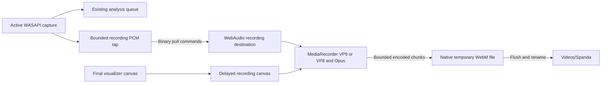

# Recording architecture and validation

Recording is an opt-in consumer of existing active Windows loopback capture. It does not open a microphone, route playback, or replace the analysis pipeline.

## Data paths

The audio graph connects buffer sources only to a `MediaStreamAudioDestinationNode`, never to audible playback. The captured mix can include any application using the Windows default output, not just Spotify.

## Capture and synchronization

`RecordingTap` queues timestamped interleaved float32 samples with sample rate and channel count. Its producer does not contend with PCM serialization on the consumer lock. A separate binary command returns packets without JSON/base64 sample-array overhead. Queue overflow aborts recording rather than accumulating unlimited delay.

The frontend validates packets, creates stereo buffers (including mono duplication and standard multichannel downmix), and schedules them on the AudioContext clock. Timestamp gaps become silence; unacceptable scheduling drift is an error. Video frames pass through a bounded delay queue to align with the audio scheduling lead. This alignment design still needs long-session measurement across devices.

The clean canvas is captured after scene rendering and crossfades, so the HUD is excluded. The recording canvas uses `captureStream(30)` with automatic frame capture. It does not require a frame processor or MP4-specific video priming.

## Encoding and saving

The encoder requests WebM with VP9 video and Opus audio, falling back to VP8/Opus when VP9 is unavailable. Unsupported runtimes report an error; MP4 encoding is not selected.

The native writer checks the first chunk's EBML signature and session identity before writing. This verifies the container header, not complete audio/video playback correctness.

Encoded chunks are written serially to a session-owned `.webm.part` file. Successful completion flushes/syncs the file and renames it to `.webm` inside the Windows Videos folder's `Spanda` subdirectory. Failed/cancelled sessions remove unfinished output where possible. Existing recordings are not converted or renamed.

| Bound | Value |
| --- | --- |
| Queued native PCM | 2 MiB; at most 256 packets |
| Maximum encoded chunk | 8 MiB |
| Pending frontend encoded writes | 16 MiB |
| Maximum native file | 512 MiB |
| Clip duration | Five minutes |
| Recording dimensions/rate | Up to 1280x720 at 30 fps |

Resolution follows the current render resolution, with a fixed recording canvas for the clip. Window resizing letterboxes/fits subsequent frames inside those dimensions. Recording-only frame/audio resources are released when it finishes or fails.

## Lifecycle

- Recording is enabled only while capture is running.
- Stop/save ends the encoder, waits for queued writes, and attempts finalization.
- Capture stop or output recovery ends the clip and attempts to save.
- Graphics-context loss, encoder errors, invalid container headers, synchronization errors, or write failures produce an error rather than a success state.
- Closing the app aborts an unfinished recording; it does not silently claim that clip was saved.
- A hidden HUD retains a `Recording` badge that also stops/saves on click. Completion/error makes controls visible again.

## Current verification status

Real Windows loopback recording was previously exercised with WebM audio/video. Recording now uses WebM again after the MP4 path produced missing-track errors. Automated tests cover codec selection/fallback, combined video/audio tracks, encoded writes, unsupported runtimes, stale-session handling, queue bounds, and file cleanup.

Verify a fresh app's first WebM clip, decoded video/audio playback, seeking, audiovisual synchronization, shutdown, and device changes. The restored path has not yet been manually exercised again.
